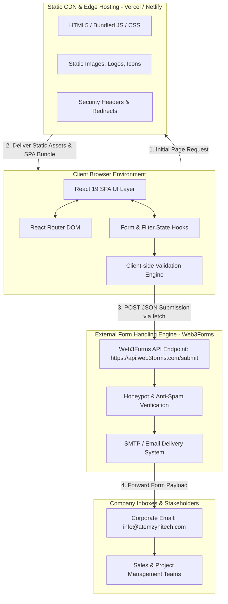
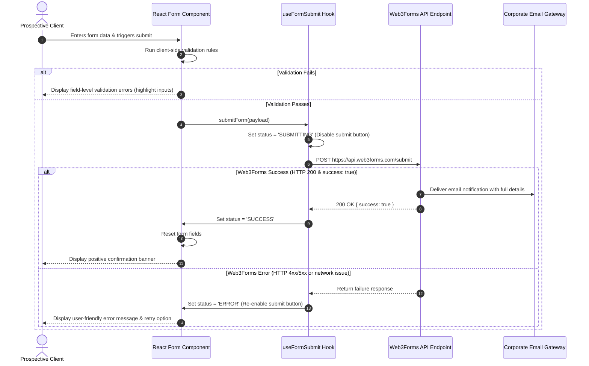
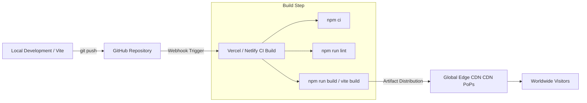

# Architecture Document: Atemzy Hitech Corporate Website

**Document Version:** 1.0  
**Status:** Approved for Implementation  
**Target Platform:** Web (Desktop, Tablet, Mobile)  
**Primary Tech Stack:** React.js, Vite, Tailwind CSS, React Router, Web3Forms  
**Target Hosting:** Vercel / Netlify (Jamstack / Static Single Page Application)

---

## 1. Executive Summary & Architectural Vision

Atemzy Hitech Engineering Services Ltd requires a modern, fast, secure, and visually commanding corporate web application. The platform serves as the central digital touchpoint showcasing multidisciplinary capabilities across:
- **Engineering Services & Consultancy**
- **Building & Civil Construction**
- **Procurement & Technical Supplies**
- **Real Estate & Property Management**
- **General Trading & Commercial Distribution**

### Core Architectural Decisions
1. **Serverless Jamstack Model (SPA):** High performance, maximum availability, ultra-low operational overhead, and zero backend maintenance vulnerabilities.
2. **Static-First Data Management:** Services, projects, company milestones, and credentials are typed and organized in centralized static data modules (`src/data/`), allowing instantaneous loads without database latency.
3. **Serverless Form Pipeline:** Lead generation and quotation requests are routed through **Web3Forms** with client-side input validation, honeypot spam protection, and real-time user feedback states.
4. **Tailwind Design System:** High-impact modern aesthetics adhering to an industrial/corporate palette (Deep Charcoal/Navy, Crisp Slate/White, and Vibrant Precision Accent Gold/Orange) with responsive fluidity across all device viewports.

---

## 2. High-Level System Architecture

The following diagram illustrates the deployment topology, runtime communication, and data boundaries:



---

## 3. Directory & Module Architecture

The codebase is structured under `corporateWeb/src/` to ensure strict separation of concerns, reusability, and modular testability:

```text
corporateWeb/
├── public/
│   ├── favicon.ico
│   ├── logo.svg
│   ├── robots.txt
│   ├── sitemap.xml
│   └── images/
│       ├── hero/
│       ├── services/
│       ├── projects/
│       └── team/
├── src/
│   ├── assets/
│   │   └── brand/               # Brand SVGs and iconography
│   ├── components/
│   │   ├── common/              # Atomic reusable UI components
│   │   │   ├── Button.jsx
│   │   │   ├── Card.jsx
│   │   │   ├── Badge.jsx
│   │   │   ├── Input.jsx
│   │   │   ├── Select.jsx
│   │   │   ├── TextArea.jsx
│   │   │   └── Modal.jsx
│   │   ├── layout/              # Structural wrappers
│   │   │   ├── Navbar.jsx       # Responsive header with mobile drawer
│   │   │   ├── Footer.jsx       # Corporate footer & quick links
│   │   │   ├── PageHeader.jsx   # Consistent banner across inner pages
│   │   │   └── ScrollToTop.jsx  # Route change scroll reset
│   │   ├── forms/               # Form implementations & feedback
│   │   │   ├── ContactForm.jsx
│   │   │   ├── QuoteForm.jsx
│   │   │   └── FormAlert.jsx    # Success, error, and loading alerts
│   │   └── sections/            # Composite page-specific sections
│   │       ├── Hero.jsx
│   │       ├── ServiceCard.jsx
│   │       ├── ProjectCard.jsx
│   │       ├── WhyChooseUs.jsx
│   │       ├── StatCounter.jsx
│   │       └── CTASection.jsx
│   ├── data/                    # Single source of truth static data
│   │   ├── company.js           # Vision, mission, values, contacts
│   │   ├── services.js          # Detailed service catalog & categories
│   │   ├── projects.js          # Portfolio items, specs, and status
│   │   └── navigation.js        # Header/footer link structures
│   ├── hooks/                   # Custom React hooks
│   │   ├── useFormSubmit.js     # Web3Forms API lifecycle & state hook
│   │   └── useScrollLock.js     # Lock scroll for mobile menu/modals
│   ├── pages/                   # Top-level route views
│   │   ├── Home.jsx
│   │   ├── About.jsx
│   │   ├── Services.jsx
│   │   ├── ServiceDetail.jsx    # Dynamic route: /services/:slug
│   │   ├── Projects.jsx
│   │   ├── RequestQuote.jsx
│   │   ├── Contact.jsx
│   │   ├── PrivacyPolicy.jsx
│   │   └── NotFound.jsx
│   ├── utils/                   # Helper functions
│   │   ├── validation.js        # Input validation & regex helpers
│   │   └── formatters.js        # Text truncation, date formatters
│   ├── App.jsx                  # Main routing orchestration
│   ├── main.jsx                 # React root initialization
│   └── index.css                # Tailwind directives & design tokens
├── .env.example                 # Template for environment variables
├── index.html                   # HTML entry point with SEO tags
├── tailwind.config.js           # Theme configuration & color tokens
├── vite.config.js               # Bundler settings & path aliases
└── package.json
```

---

## 4. Component Hierarchy & Navigation Routing

### 4.1 Routing Structure (`React Router v6/v7`)

| Path | Component | Description |
|---|---|---|
| `/` | `Home.jsx` | Full homepage experience with hero, highlights, and CTAs |
| `/about` | `About.jsx` | Company history, mission, vision, values, credentials |
| `/services` | `Services.jsx` | Complete listing of all 5 business pillars |
| `/services/:slug` | `ServiceDetail.jsx` | Deep dive into specific engineering or trading service |
| `/projects` | `Projects.jsx` | Filterable portfolio of civil, technical, & supply projects |
| `/quote` | `RequestQuote.jsx` | Comprehensive multi-field quotation request form |
| `/contact` | `Contact.jsx` | Office location, phone, email, and general enquiry form |
| `/privacy` | `PrivacyPolicy.jsx` | Form data handling and privacy notice |
| `*` | `NotFound.jsx` | 404 error page with navigation back to homepage |

### 4.2 Application Shell Tree
```text
<App>
  <BrowserRouter>
    <ScrollToTop />
    <Navbar />
    <main id="main-content">
      <Routes>
        <Route path="/" element={<Home />} />
        <Route path="/about" element={<About />} />
        <Route path="/services" element={<Services />} />
        <Route path="/services/:slug" element={<ServiceDetail />} />
        <Route path="/projects" element={<Projects />} />
        <Route path="/quote" element={<RequestQuote />} />
        <Route path="/contact" element={<Contact />} />
        <Route path="/privacy" element={<PrivacyPolicy />} />
        <Route path="*" element={<NotFound />} />
      </Routes>
    </main>
    <Footer />
  </BrowserRouter>
</App>
```

---

## 5. Data Models & Schemas

Static data files in `src/data/` function as the mock database and content layer.

### 5.1 Service Schema (`src/data/services.js`)
```javascript
export const services = [
  {
    id: "eng-consultancy",
    slug: "engineering-consultancy",
    title: "Engineering Consultancy & Technical Services",
    category: "Engineering Services",
    summary: "Expert technical guidance, feasibility studies, and engineering oversight.",
    fullDescription: "Detailed breakdown of engineering consultancy...",
    features: [
      "Structural analysis & integrity verification",
      "Civil & mechanical project design",
      "Quality assurance and compliance audits"
    ],
    icon: "Wrench", // Lucide React icon name
    image: "/images/services/engineering.webp",
    featured: true
  },
  // Additional services: Construction, Procurement, Real Estate, Trading
];
```

### 5.2 Project Portfolio Schema (`src/data/projects.js`)
```javascript
export const projects = [
  {
    id: "proj-001",
    slug: "commercial-complex-reinforcement",
    title: "Structural Reinforcement & Civil Works",
    category: "Construction",
    clientType: "Corporate",
    location: "Lagos, Nigeria",
    status: "Completed", // "Completed" | "In Progress"
    year: "2025",
    description: "Full civil engineering and concrete structural work for multi-story facility.",
    images: [
      "/images/projects/proj-1-main.webp",
      "/images/projects/proj-1-detail.webp"
    ],
    featured: true
  }
];
```

### 5.3 Corporate Identity Schema (`src/data/company.js`)
```javascript
export const companyInfo = {
  name: "Atemzy Hitech Engineering Services Ltd",
  shortName: "Atemzy Hitech",
  tagline: "Engineering Solutions. Construction Excellence. Reliable Service.",
  rcNumber: "RC-XXXXXXX", // Verified Registration
  contact: {
    phone: "+234 (0) 800 000 0000",
    email: "info@atemzyhitech.com",
    address: "Commercial District, Lagos, Nigeria",
    workingHours: "Mon - Fri: 8:00 AM - 5:00 PM"
  },
  socials: {
    linkedin: "https://linkedin.com/company/atemzy-hitech",
    whatsapp: "https://wa.me/234XXXXXXXXXX"
  }
};
```

---

## 6. Form Handling & Web3Forms Integration Pipeline

Forms are critical conversion touchpoints. The architecture enforces an isolated, secure, and user-friendly submission pipeline.

### 6.1 Form Data Flow



### 6.2 Security & Anti-Abuse Measures
- **Honeypot Anti-Spam Field:** A hidden input `<input type="checkbox" name="botcheck" class="hidden" style="display: none;">` triggers an instant rejection if bots autofill it.
- **Client Access Key Segregation:** The Web3Forms access key is injected via `import.meta.env.VITE_WEB3FORMS_ACCESS_KEY`.
- **Duplicate Request Throttling:** The submit button is immediately disabled and given a spinning state upon initial click until a response or timeout (10 seconds) occurs.
- **No Sensitive Credentials in Bundle:** No mail server credentials, SMTP passwords, or admin tokens exist in the client repository.

---

## 7. Design System & Styling Architecture

The user interface utilizes **Tailwind CSS** with a customized corporate theme:

### 7.1 Color Tokens
- **Brand Navy / Primary (`brand-900`):** `#0B192C` (Commanding, stable, authoritative)
- **Brand Slate / Secondary (`brand-800`):** `#1E3E62` (Deep engineering nuance)
- **Precision Gold / Accent (`accent-500`):** `#F97316` / `#E65100` (High visibility action points, construction safety, industrial precision)
- **Neutral Light (`surface-50`):** `#F8FAFC` (Clean backdrop for readable technical copy)
- **Text Primary (`text-900`):** `#0F172A` (Highest contrast for WCAG 2.1 AA)

### 7.2 Typography & Iconography
- **Typography:** `Inter` or `Plus Jakarta Sans` imported via Google Fonts for modern readability.
- **Iconography:** `lucide-react` for tree-shaken, ultra-light SVG icons representing tools, buildings, logistics, and communication channels.

---

## 8. Non-Functional Specifications & Quality Attributes

### 8.1 Performance & Optimization
- **Vite Production Bundling:** Aggressive tree-shaking, code-minification using esbuild/terser.
- **Route-Level Code Splitting:** Heavy page views dynamically loaded using `React.lazy()` and `Suspense` fallback skeletons.
- **Asset Formats:** All hero and project imagery converted to `.webp` format with explicit `width`, `height`, and `loading="lazy"` attributes to prevent cumulative layout shifts (CLS < 0.1).

### 8.2 SEO & Structured Data
- **Semantic HTML5:** Strict utilization of `<header>`, `<nav>`, `<main>`, `<section>`, `<article>`, `<aside>`, and `<footer>`.
- **Heading Hierarchy:** Enforce a single `<h1>` per page, followed by logical `<h2>` and `<h3>` tags.
- **JSON-LD Schema:** Embed `Organization` and `ProfessionalService` structured schema into `index.html` to maximize Google Search rich snippet visibility.
- **OpenGraph & Twitter Cards:** Comprehensive social preview images and descriptions for sharing across WhatsApp, LinkedIn, and X.

### 8.3 Accessibility (a11y)
- Target: **WCAG 2.1 Level AA Compliance**.
- Keyboard-accessible interactive elements (tabindex, focus rings, skip-to-content anchor).
- ARIA live regions (`aria-live="polite"`) for form validation and submission feedback alerts.
- Form inputs linked via explicit `id` and `htmlFor` pairings.

---

## 9. CI/CD & Deployment Pipeline



### Hosting Configuration
- **Vercel (`vercel.json`) / Netlify (`_redirects`):**  
  SPA rewrite rule routing all paths to `/index.html`:
  ```text
  /*    /index.html   200
  ```
- **Environment Variables:** Set `VITE_WEB3FORMS_ACCESS_KEY` in the hosting platform's project settings dashboard.

---

## 10. MVP Implementation Checklist & Traceability Matrix

Direct mapping of the client MVP requirements to technical components and file deliverables:

### 10.1 Website Core Deliverables
| MVP Requirement | Implementation Target | Key Components / Artifacts | Verification Method |
|---|---|---|---|
| **Responsive navbar and footer** | `src/components/layout/Navbar.jsx`<br>`src/components/layout/Footer.jsx` | Mobile drawer toggle, sticky header, quick links, social links, contact snippets | Viewport resize (320px - 1440px), hamburger menu toggle |
| **Home page** | `src/pages/Home.jsx` | `Hero.jsx`, `WhyChooseUs.jsx`, `ServiceCard.jsx` preview, `ProjectCard.jsx` preview, `CTASection.jsx` | Visual review, CTAs route to quote/services |
| **About page** | `src/pages/About.jsx` | Company history, mission, vision, values, credentials, registration details | Content accuracy against verified company info |
| **Services page** | `src/pages/Services.jsx`<br>`src/pages/ServiceDetail.jsx` | Dynamic service cards, categories (Engineering, Construction, Procurement, Real Estate, Trading) | Category filtering, slug routing, "Request Quote" deep links |
| **Projects or capabilities section** | `src/pages/Projects.jsx` | `ProjectCard.jsx`, category filter buttons, status badges | Filter by service type, modal/detail view check |
| **Contact page** | `src/pages/Contact.jsx` | Company phone, email, physical office address, business hours, embedded map/directions | Accuracy of contact info, responsive layout |

### 10.2 Enquiries & Lead Capture
| MVP Requirement | Implementation Target | Key Components / Artifacts | Verification Method |
|---|---|---|---|
| **Contact form** | `src/components/forms/ContactForm.jsx` | Name, Email, Subject, Message fields | Form renders cleanly on desktop & mobile |
| **Request a Quote form** | `src/pages/RequestQuote.jsx`<br>`src/components/forms/QuoteForm.jsx` | Name, Email, Phone, Org, Service Category dropdown, Location, Scope, Budget | All mandatory fields captured; service pre-selection |
| **Client-side validation** | `src/utils/validation.js` | Email regex, required field checks, phone format validation | Error messages render per input, submit blocked until valid |
| **Serverless form endpoint** | `src/hooks/useFormSubmit.js` | Web3Forms API gateway (`https://api.web3forms.com/submit`) | Network tab inspection on fetch POST |
| **Web3Forms delivery tested** | Environment config + Live inbox | `VITE_WEB3FORMS_ACCESS_KEY` in `.env` | Verified receipt of notification email in recipient inbox |
| **Success and error messages** | `src/components/forms/FormAlert.jsx` | Banner alerts, button loading spinner, disable double-click | Visually confirmed on success, error simulation tested |

### 10.3 Pre-Launch & Deployment
| MVP Requirement | Implementation Target | Key Components / Artifacts | Verification Method |
|---|---|---|---|
| **Company details & images verified** | `src/data/company.js`<br>`public/images/` | High-res WebP imagery, verified phone/email/RC number | Review with corporate stakeholders; no placeholder leaks |
| **Mobile and desktop testing** | Chrome DevTools, Safari iOS, Android | Responsive Tailwind utilities, touch targets ≥ 48px | Zero horizontal scroll, font legibility on 375px screens |
| **SEO titles and descriptions** | `index.html` + dynamic title hook | Unique title tags, meta descriptions, OpenGraph tags | Google Rich Results Test, social share preview debugger |
| **Privacy notice** | `src/pages/PrivacyPolicy.jsx` | Web3Forms data disclaimer, inquiry retention terms | Clear link in footer and quote form disclaimer |
| **HTTPS deployment** | Vercel / Netlify Edge | SSL certificate (auto-renewed Let's Encrypt), SPA redirects | Lock icon in browser, HTTP-to-HTTPS 301 redirects |

---

## 11. Future Evolution & Extensibility Roadmap

| Stage | Focus | Architecture Transition |
|---|---|---|
| **Phase 1 (Current)** | Frontend Jamstack | Static data in JS, Web3Forms, React 19 SPA, Tailwind CSS |
| **Phase 2** | Dynamic Content | Integration of Headless CMS (e.g. Sanity or Strapi) for real-time project additions without code deploys |
| **Phase 3** | Client Portal | Node.js/Supabase backend for quotation tracking, client authentication, and invoice downloads |
